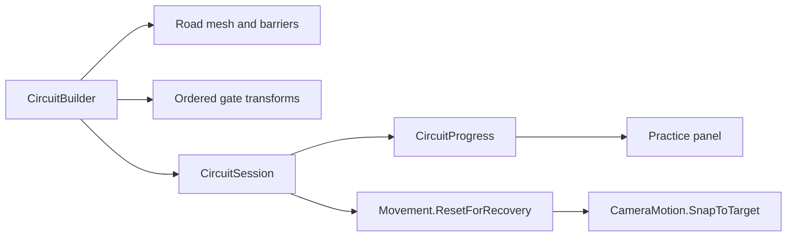
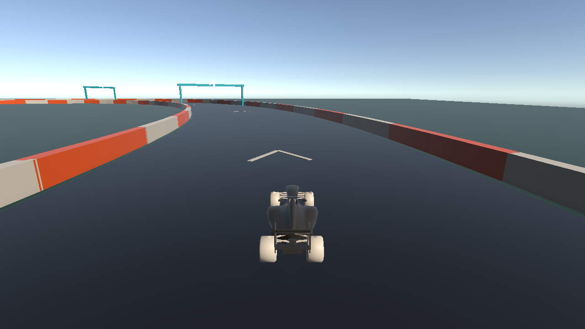

# Closed circuit, checkpoints and recovery

## Playing this milestone

Stop Play Mode, open **Assets/Scenes/MVP Circuit.unity**, then press Play. Track
geometry appears when Play starts. F1 Demo remains a separate driving test scene.
The circuit is now the enabled desktop build scene.

P accelerates, O brakes, A/D steer, comma/period shift and **R recovers**. The
practice panel shows speed, gear, the next gate and completed laps. Drive through
1 -> 2 -> 3 -> 4 -> 5 -> 6 -> 7 -> START / FINISH. Starting just past the finish
line does not count a lap. This is practice progression; timed races and a results
screen are the next milestone.

## Architecture

CircuitBuilder constructs an ellipse with a continuous, flat road mesh, alternating
barriers, directional chevrons and eight numbered gates. It reuses the existing F1
prefab, light and follow camera from the demo. The inherited huge cube and old
fixed-resolution HUD are disabled only in the new scene. A compact practice panel
provides the controls and checkpoint state while the final race HUD is pending.

The centerline is p(t) = (65 cos(t), 0, 100 sin(t)). Its forward tangent is the
normalized derivative (-65 sin(t), 0, 100 cos(t)). Cross(up, tangent) gives the
lateral direction; offset the centerline by +/- half the road width to construct
the road edges. Adjacent pairs form two upward-facing triangles. Barriers follow
the same edges, just outside the 16 m road. There are 128 segments and eight gates.

This is a greybox for gameplay acceptance, not final track art. Runtime generation
keeps dimensions easy to change without external art or hand-maintained scene
geometry. Tradeoffs: the track appears only in Play Mode, uses simple segmented
barriers, and has no banked turns or optimized barrier batching. Select the MVP
Circuit root before playing to adjust radii/width. Keep that root at identity;
geometry coordinates are world coordinates. A later editor baking tool could make
it directly editable in Scene view.

## Checkpoint algorithm

CircuitProgress stores next gate, last accepted gate and completed laps. It accepts
only the expected gate index. Next is (accepted + 1) mod 8. Finish gate 0 increments
laps only after gates 1 through 7. Duplicate or out-of-order gates do not mutate
state. Resetting the car never calls TryPass, so repeated recovery cannot earn laps.

CircuitSession samples the Rigidbody center every physics tick. Each gate's inverse
transform converts the previous and current position into gate-local coordinates.
A valid forward crossing goes from z < 0 to z >= 0. At the crossing plane,

    fraction = -previous.z / (current.z - previous.z)
    crossing = previous + fraction * (current - previous)

The crossing must lie within half the road width and 3 m vertically of the gate
center. This rejects driving around or flying over a gate. The line segment sweep
also detects a fast car that passes completely through a thin gate between ticks.
It avoids duplicate callbacks from the body and wheel colliders. Backward crossings
are ignored; an out-of-order forward crossing displays feedback. The cost is O(8)
per tick. At most one gate is accepted per tick; normal speeds and gate spacing
make multiple valid gates in a single 20 ms step implausible on this course.

Example: from local (0, 0, -4) to (2, 0, 6), fraction = 0.4, crossing x = 0.8,
which is inside an 8 m half-width. From (9, 0, -4) to (9, 0, 6), crossing x = 9,
so no checkpoint is awarded.

This is not a competitive anti-cheat system. A later authored course with overlapping
segments or external teleport mechanics would need additional validation.

## Recovery transaction

R schedules recovery on the next physics tick. Falling below y = -8 also recovers.
The pose is the last valid gate's center, 6 m beyond its plane and raised above the
road, facing that gate's forward direction. Initial recovery uses start/finish.
Movement clears pedals, steering, gear, drive/brake forces, linear/angular velocity
and recreates enabled wheel simulation state. Input is held neutral for 0.5 s to
settle the car. The camera snaps to its normal offset instead of travelling across
the infield. Session resets its previous sample and ignores crossings for 0.5 s.
These steps prevent the teleport segment from being mistaken for forward progress.

A flipped or stuck vehicle is recovered manually with R; automatic flip detection
is intentionally absent to avoid interrupting normal cornering or jumps. Recovery
retains accepted checkpoints and completed laps, unlike a future race restart.

## Manual acceptance

1. Start the new scene: verify the car faces the arrows, the road is visible,
   the vehicle settles, and the Console has no gameplay errors.
2. Drive all gates in order; finish increments the lap exactly once. Repeat.
3. Cross finish immediately or go to a later gate: no lap/progress should be awarded.
4. Drive backward through a gate: it must not advance progress. Cross it forward
   when it is expected: it should then advance.
5. After accepting gate 2, press R while moving: return beyond gate 2, facing forward,
   stopped in first gear, with gate 3 still expected. Repeat R; progress stays fixed.
6. Flip or wedge the car against a barrier and recover. Check no retained wheelspin,
   camera lag across the infield, or sudden launch after the neutral interval.
7. Verify barriers contain the car, arrows point forward and labels face approaching
   traffic. Tune speed/braking for the turns; a full handling pass is still needed.
8. Test a desktop build separately. Compilation and automated smoke tests do not
   establish driving feel, material appearance or full circuit playability.

## Exercises

- Change gate count: identify the code and test assumptions that must change.
- Derive the crossing point for (-12, 1, -3) to (12, 1, 9). Does it count?
- Explain why restoring a pose without resetting the previous position could
  accidentally accept a checkpoint.
- Design an event emitted on accepted checkpoint so a future race timer need not
  read HUD text or poll a UI component.

## Automated validation results

Unity **6000.1.0f1** compiled the project and completed both validation phases in a
disposable project copy. `CircuitValidation.Run` checks two ordered laps, premature
finish, skipped/duplicate/invalid gates, backward and off-width/off-height crossings,
a high-speed sweep and the interpolated crossing point. Scene checks verify the
builder and existing wheel references. Play Mode checks verify road collider creation,
upward road normals, all gates, car spawn, a requested recovery with initial linear
and angular momentum, and unchanged progress after recovery. Both phases logged PASS
and the Editor process exited with code 0. This supersedes the earlier audit's local
Editor availability limitation for this milestone.

To rerun, copy Assets, Packages and ProjectSettings to a temporary directory and run
Unity 6000.1.0f1 with `-batchmode -nographics -projectPath <copy>` and
`-executeMethod CircuitValidation.Run -logFile <log>`. Do not use `-quit`: the
validator enters Play Mode, performs its checks and exits on completion. An optional
`-circuitScreenshot <absolute-png-path>` captures the follow camera when graphics
are enabled (omit `-nographics`). Use a copy to avoid locking the active project.

A graphics-enabled run also passed both phases. The follow-camera preview was
rendered and inspected: road, chevrons, barriers, gates and vehicle are visible.
An initial grayscale-material problem was fixed by setting URP's _BaseColor
explicitly. Gate text uses the built-in LegacyRuntime font. This camera-only
capture excludes the OnGUI practice panel; that panel still needs manual review.

