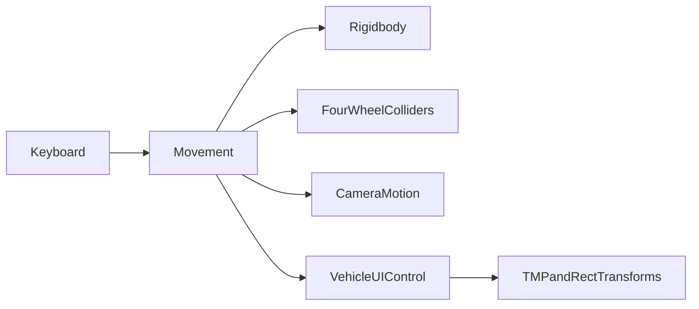

# MVP audit and implementation plan

Baseline: d66ed52. Audited 2026-10-23 on feature/single-player-mvp.
This is a source and serialized-data audit, not confirmation of gameplay.

## Architecture

Movement lives on the F1 prefab's Car child, with a 400 kg Rigidbody and a box
collider. Its four assigned WheelColliders are ordered front right, front left,
rear right, rear left. Rear wheels receive drive torque. The Player tag is on
another child (Contr), rather than the controller object. CameraMotion originally
searched that tag while separately reading Movement. VehicleUIControl reads vehicle
state and writes TMP speed/gear labels and three RectTransform indicators.

F1 Demo instantiates the prefab and connects both camera and HUD to its Movement
component. All eight HUD references are assigned. Its serialized overrides set
300 Nm engine torque, 3000 Nm brakes and a custom four-key torque curve. Some
obsolete engineTorque overrides remain in the scene; preserve until Editor cleanup.
SampleScene has a camera, light, volume and cube, with no vehicle or gameplay scripts.
The original build configuration enabled only SampleScene.

Unity version: 6000.1.0f1. URP 17.1.0, Input System 1.14.0, UGUI 2.0.0,
Test Framework 1.5.1. Legacy and new input are both enabled (activeInputHandler 2).
The input-actions asset exists but the gameplay scripts use legacy Input.GetKey.
Physics timestep is 0.02 seconds (50 Hz). No dependency upgrades are needed now.

## System inventory before implementation

| System | Evidence and status |
| --- | --- |
| Vehicle model/materials | Present; external Formula One Car asset origin recorded in metadata |
| Rigidbody and four WheelColliders | Present and referenced; contact geometry and handling unverified |
| Rear drive, eight manual gears, torque curve | Implemented but render-rate dependent; not play-tested |
| Speed/gear/pedal/steering HUD | Implemented and wired in demo; visual layout unverified |
| Follow camera | Implemented but stationary follow freezes; offset collapses with speed |
| Driving surface | Demo cube collider exists; no authored playable circuit established |
| Race/checkpoint/lap systems | Missing from gameplay source and scene components |
| Countdown/completion/restart/pause | Missing |
| Best lap persistence | Missing |
| Engine/brake audio and race feedback | No gameplay audio implementation |
| Release/docs/ignore rules | No release or project README/.gitignore at baseline |

## Prioritized risks

1. Builds launch the wrong scene. Correct this before testing a player build.
2. Wheel forces and fixed increments run in Update, making response depend on FPS.
3. Base prefab engine torque is zero; its curve also starts at zero. Demo overrides
   mask these issues. An idle RPM floor and nonzero prefab torque permit launch.
4. Steering never reliably centers without W and oscillates around zero with W.
5. Camera interpolation uses speed; no stable chase offset exists.
6. Brake allocation doubles the intended total budget (70% to each front wheel).
   Correcting it changes stopping distance and requires brake tuning.
7. No ordered checkpoints or race state exist, so a complete race is impossible.
8. Public mutable runtime state and unchecked dependencies make errors difficult
   to isolate. Per-frame RPM logging floods the Console.
9. Model forward axis, wheel suspension/friction, camera framing, ground extent,
   material compatibility and UI scaling need visual inspection.
10. Asset redistribution/license rights must be established before a public release;
    asset metadata alone does not establish redistribution rights.

## Incremental roadmap and acceptance gates

1. **Driving baseline (implemented, Editor acceptance pending).** Fixed-step physics,
   time-based inputs, bounded manual gearbox, idle/redline approximation, stable
   camera, validated references, demo build scene. Gate: launch, steer, brake and
   shift with no Console errors at 30/60/120 render FPS.
2. **Playable circuit and recovery.** Reuse F1; author a simple closed course,
   ordered directional checkpoint triggers, spawn/recovery pose and reset control.
   Gate: drive a complete circuit; skipping or reversing gates cannot earn a lap.
3. **Race loop.** Separate race state from vehicle physics. Countdown -> racing ->
   finished; configurable lap count, monotonic lap/race timing and restart.
   Gate: three-lap race completes exactly once; restart clears transient state.
4. **HUD/pause/persistence.** Race HUD, pause menu, restart confirmation where
   useful, best valid lap saved with a track/version key. Gate: pausing adds no lap
   time, reload retains best lap, restart restores timeScale and controller state.
5. **Polish and release.** Engine sound driven by RPM, checkpoint/finish feedback,
   camera/handling tuning, setup README, architecture notes, screenshots and desktop
   build. Gate: clean import, successful build and end-to-end playthrough.

Commit each coherent milestone on this feature branch. Do not merge main without
approval. Do not advertise missing systems in a resume. The learning notes below
are source material for the future textbook, not a finished PDF.

## Validation available here

The Unity CLI exists at ~/.unity/bin/Unity; it is not the Editor executable.
`Unity editors --json` returned an empty installed-editor list. `Unity status
--json` returned no connected Editor. /Applications has Unity Hub but no Editor
installation in the standard Hub path. C# compilation, Play Mode, visual QA and
release building have therefore not been performed. Source inspection and local
reference checks cannot substitute for these gates.
